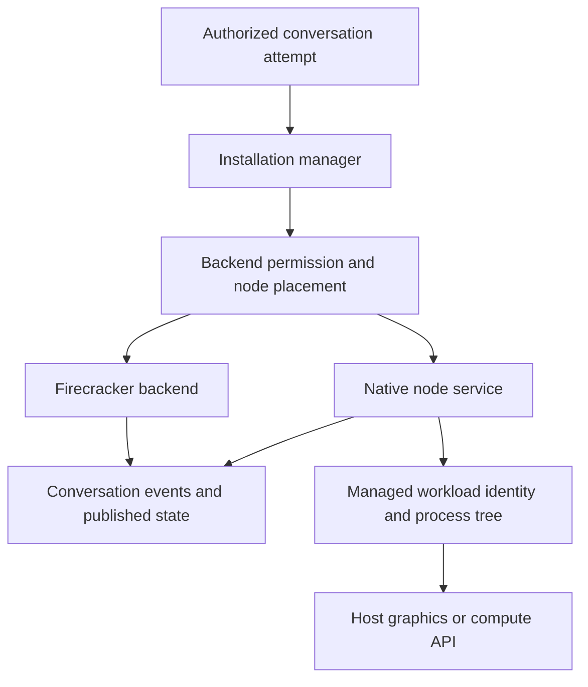

# Native execution on trusted nodes

Status: proposed. This document adds no executable backend, permission, storage
format or deployment. The confirmed trust requirement is **selected agents used
by trusted people**; the mechanisms below are proposals for review.

## Purpose and tradeoffs

Cairn should let an owner contribute a PC while continuing to use it. Propose an
opt-in native backend alongside Firecracker: an agent runs as a managed OS process
and uses the installed GPU driver through ordinary application APIs. This avoids
developing a virtual GPU and lets graphics and AI workloads share the owner's GPU.
Applications still need compatible libraries and drivers for their OS and GPU.

Native execution trades the VM boundary for access to the host OS. A separate
unprivileged workload identity reduces access, but does not provide Firecracker's
isolation. Trusted callers can still submit destructive commands or encounter
prompt injection. GPU workloads can exhaust VRAM, slow the desktop or trigger a
driver fault; preserving interactive responsiveness is an operating goal, not a
hard guarantee. No GPU detachment, driver replacement or desktop shutdown is
required by this design.

Start with Linux, managed workspaces and conservative concurrency. Keep the
installation manager on Linux. Extract a portable node execution service rather
than porting the complete installation crate to Windows and macOS.

## Relationship to existing decisions

- This proposes reopening [the decision to defer GPU access until Firecracker
  supports it](adr/0003-defer-gpu-until-direct-firecracker-support.md) for explicitly
  trusted native execution. Firecracker remains available with its existing contract.
- [S3-backed disks on every node](adr/0009-s3-backed-disks-required-on-every-node.md)
  requires FUSE and a published disk for isolated conversations. Native execution
  needs a separate file-publication contract described below. Approval and
  implementation of that extension must precede enabling native execution; simply
  skipping the storage probe would silently break the existing contract.
- [Coding-agent execution adapters](adr/0037-coding-agent-execution-adapters.md)
  select the coding engine and its protocol. A host execution backend is a separate
  concern: both Firecracker and native execution should use those adapters.
- [Installation sharing](adr/0029-sharing-whole-installations.md) does not grant
  native access automatically. Conversations remain visible across the installation;
  this proposal adds an execution permission, not private member workspaces.

The current implementation has only `Backend::Firecracker` in
[`execution/prepared.rs`](../crates/installation/src/execution/prepared.rs).
[`service.rs`](../crates/installation/src/service.rs) rejects production execution
without a runner, and [`nodes/placement.rs`](../crates/installation/src/nodes/placement.rs)
requires KVM and FUSE. Development host execution is not a production native backend.

## Common lifecycle and platform ownership

The manager owns authorization, attempt identity, placement, account grants, event
ordering and publication references. A backend owns prepare, start, event transport,
stop, checkpoint, cleanup and recovery on its node. The portable protocol carries
backend kind, OS/architecture, supported coding engines, protocol versions and
verified capabilities. Capabilities and tags never confer permission.

Backend selection is explicit. Existing conversations retain their backend and
storage kind. There is no automatic fallback from Firecracker to native execution.
Backend-specific readiness checks replace the assumption that every ready node
has KVM, FUSE and the same runner image. Unknown or incompatible backends fail.

## Permissions and credentials

Native access requires all of the following at admission and resume:

1. The owner has enabled native execution on the selected node.
2. The agent has an explicit native grant for that node. Existing wildcard node
   access does not imply a native grant.
3. The person directing the work has explicit native permission. An approved agent
   alone is insufficient because other installation members can use it.
4. The conversation, current attempt and node lease remain authorized.

Apply the same intersection to scheduled work and external plugin delegations.
Scheduled work retains the author's identity and current rights; delegation must
have its own explicit native scope. Subagents inherit a subset of the originating
grant and cannot change backend or expand it. Every message capable of directing
work, including follow-ups in a shared conversation, is checked before dispatch.
Define and test the principal propagation before enabling any such entry point.

Revalidate authorization on lease renewal. Revocation prevents new work, invalidates
runtime grants and requests a stop of the owned workload. Network partitions are
bounded by lease expiry; they cannot provide instantaneous remote revocation.

Run workloads under an unprivileged identity separate from the supervisor and
updater, with private conversation directories. Changing `HOME` alone does not
enforce filesystem permissions. Node enrollment credentials, update authority,
manager secrets and bucket credentials must be unreadable by workloads. Broker
short-lived, attempt-scoped access to the accounts, projects and services the run
is authorized to use. Credentials deliberately supplied to a coding engine remain
accessible to that engine and must not be treated as protected from its commands.

The first release exposes only managed workspaces and explicitly approved tools.
Access to the owner's personal files, desktop session, administrator privileges or
Docker socket requires a separate capability and design review.

## Ownership, resource limits and cleanup

Each execution has a durable attempt identifier, generation and expiring lease.
Before starting a replacement, establish that the previous workload cannot continue
writing the same workspace. Publication rejects stale generations. A lease in the
manager alone cannot stop an offline process: the node needs a local watchdog and
OS-enforced ownership of the process tree. If exclusion cannot be established,
keep the conversation unavailable rather than allow concurrent writers.

On Linux, use a dedicated cgroup or service scope with descendant cleanup and
CPU/RAM limits. Process groups or killing just the CLI parent are insufficient.
Supervisor crash, node reboot, canceled attempts and lease expiry must converge on
the same cleanup path without killing unrelated processes or trusting reused PIDs.
Advertise only resource limits that the implementation can enforce. Start with
one native execution per node, disk/cache budgets and an owner pause/stop control;
ordinary consumer GPUs do not give this design a universal hard VRAM quota.

A normal stop terminates the owned process tree, captures a coherent checkpoint,
publishes it, then releases ownership. Cleanup removes only recorded Cairn-owned
paths and refuses symlink escapes. Preserve unsynchronized work and report failed
publication instead of claiming it was saved. Cleanup cannot undo arbitrary host
changes made by a process. The owner keeps using the desktop, subject to resource
contention and the permissions explicitly granted.

## Workspace publication and S3

Keep the existing Firecracker disk format. Propose a separately versioned native
file manifest for managed projects, conversation files and resumable coding-engine
state. S3 remains the installation's durable object store, reached through the
manager's scoped transfer grants; native nodes do not receive whole-bucket keys.
S3 is not a shared writable filesystem.

For the first implementation, an authoritative checkpoint follows this sequence:

1. Stop the managed workload tree and freeze writes to its private workspace.
2. Describe the included files and metadata in a manifest; upload immutable,
   content-addressed objects and verify their availability and hashes.
3. Have the manager atomically accept the manifest reference for the current
   attempt/generation, then acknowledge the new published state.
4. Retain the previous acknowledged state and required objects until that commit
   succeeds. Garbage collection must respect publication and restore references.

Background uploads may stage data, but a directory scan of a running application
does not prove a coherent checkpoint. Periodic coherent checkpoints initially
require a stop; later live snapshots need an OS-specific consistency mechanism.
A crash can lose local work since the last acknowledged publication. Show that
exposure and synchronization failures in the product. Restore must finish fetching
required files before launch; demand-paged native restore is not promised.

Publish an explicit environment inventory. Keep workspace tools and coding-engine
session data needed for same-platform resume; identify reproducible dependencies
separately from unique user data. Do not indiscriminately archive the workload's
entire home: exclude brokered credentials, sockets, caches and host-global tools.
OS packages, GPU drivers and toolchain provisioning remain node capabilities, not
portable files that S3 can reinstall by copying a directory.

Initially pin a conversation to its backend and OS/architecture. Same-platform
recovery requires a compatible node and environment inventory. Full native-to-VM
or cross-OS moves are a later feature, with explicit filename, case, symlink,
permission, toolchain and coding-engine session compatibility checks. Project
files being portable does not make a whole development environment portable.

Before implementation, review the manifest, publication transaction, retained
references and migration/failure plan against the
[installation data compatibility contract](PRODUCTION-CAIRN.md#installation-data-compatibility).
Any required epoch transition ships with that implementation. Storage changes
also require the reproducible measurements described in
[storage compression measurements](STORAGE-COMPRESSION.md). This proposal changes
neither persisted data nor the current epoch.

## Binaries, updates and skills

Publish authenticated, versioned node binaries per OS/architecture, with approved
digests and protocol compatibility ranges. Keep node, coding-engine and toolchain
versions distinct. Download and verify a candidate before draining; start it from
a versioned location, check health, then select it atomically. Preserve the previous
binary for rollback. A binary rollback does not undo an incompatible data change.
Do not replace an in-use executable or silently update OS packages/GPU drivers.
Installation-wide maintenance continues to coordinate admission and leases.

Reuse the [frozen skill bundle contract](SKILLS.md): each run gets its recorded
content-addressed revision and a working copy, rather than an editable link to the
canonical bundle. Validate extraction paths and target filesystem rules. Skill
instructions can be portable while bundled scripts require a particular shell,
runtime or OS; check those requirements and report unsupported skills explicitly.
Never substitute a newer skill revision because the pinned one is unavailable.

## Windows and macOS follow-up

Share the node protocol and coding-engine orchestration; implement and validate
OS supervision, permissions, packaging and updates separately. In particular:

| Area | Linux first | Windows follow-up | macOS follow-up |
| --- | --- | --- | --- |
| Process ownership | cgroups/service scopes | Job Objects and service ACLs | launchd and verified descendant cleanup |
| GPU work | Installed graphics/compute stack | Installed graphics/compute stack | Installed graphics/compute stack, including Metal |
| Interactive applications | Separate explicit desktop grant | Authorized per-user helper; services use session 0 | Authorized user-session helper and required consent |
| Distribution | Versioned service binary | Versioned binaries and service installer | Signed/notarized distribution and service setup |

Graphics and compute applications still depend on APIs supported by the target
platform; this is not CUDA emulation on every GPU. Headless rendering or training
does not establish support for opening game windows, capturing screens or injecting
input. Validate each coding engine and required toolchain on actual target OS CI
before advertising support.

Platform references: [systemd resource controls](https://www.freedesktop.org/software/systemd/man/latest/systemd.resource-control.html),
[Windows Job Objects](https://learn.microsoft.com/en-us/windows/win32/procthread/job-objects),
[Windows interactive services](https://learn.microsoft.com/en-us/windows/win32/services/interactive-services),
[launchd jobs](https://developer.apple.com/library/archive/documentation/MacOSX/Conceptual/BPSystemStartup/Chapters/CreatingLaunchdJobs.html),
and [Apple distribution signing](https://developer.apple.com/developer-id/).

## Delivery and acceptance

Implement one Linux path through authorization, enrollment, preparation, execution,
events, cancellation, publication, recovery and updates before adding another OS.
Keep native execution disabled until these behaviors are demonstrated:

- Unapproved agents, callers, wildcard grants, follow-ups and delegated/scheduled
  work cannot enter native execution. Revocation stops the correct owned workload.
- Reboots, supervisor crashes, network loss and stale attempts cannot create two
  writers. Cleanup reaps descendants and preserves unrelated processes and files.
- Workloads cannot read enrollment/updater/bucket credentials. Explicitly granted
  coding-engine credentials are excluded from publication.
- Failed object uploads or manifest commits preserve the previous published state;
  recovery reproduces an acknowledged workspace and pinned skill revision.
- Interrupted updates and failed health checks preserve or restore a compatible
  version without pretending an incompatible data rollback succeeded.
- Real GPU graphics and AI workloads coexist with desktop use under owner-approved
  tests, with measured contention and cancellation behavior. No hardware test is
  performed by merging this document.
- Web and Android ship the native permission, selection, health, stop and
  synchronization controls together, recording any platform differences in
  [web parity](../apps/android/docs/WEB-PARITY.md).

Exact policy fields, native manifest encoding, credential broker APIs and OS
supervision interfaces remain implementation-design work. Approval of this
proposal alone is not evidence that these guarantees are implemented or tested.
