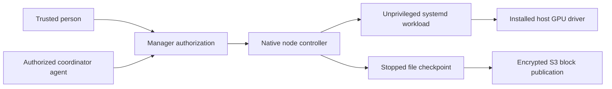

# Native execution on trusted Linux nodes

Status: implemented for Linux x86-64 in PR #292; hardware qualification is performed
by the node owner after code review. [Operator guide](NATIVE-NODES.md).
Windows and macOS are future backends, not supported installation targets in this change.
Firecracker remains the enrollment default and the backend of new conversations
whenever their agent may use a VM node. Native execution is explicit.

## Purpose and boundary

An owner can contribute a desktop's GPU while continuing to use the desktop.
Agents use ordinary host GPU libraries and drivers; Cairn never detaches a GPU,
replaces a driver, stops a desktop or grants access to the owner's desktop session.
This supports headless rendering, game builds and AI workloads with compatible
application dependencies. Interactive desktop automation is a separate feature.

The manager remains on Linux. Native nodes implement its existing authenticated
execution protocol: prepare, start, logs, wait, lease, stop, artifact export,
project opening, stopped checkpoint, restore, publication and cleanup. Native
code is behind `native/`; coding-engine adapters remain shared with Firecracker.
No fallback changes a conversation's backend. Existing VM disks remain VM disks.

## Authorization

Admission requires the node owner's native enable switch, a grant of that node to
the conversation's agent, and every directing person's presence in that node's
trusted-person list. Agents have no backend of their own: each conversation keeps
the backend of its environment and switches only through an explicit move
([ADR 0059](adr/0059-per-conversation-backend-and-in-place-vm-disks.md)). Wildcards, tags, installation
membership and an agent name never grant native execution by themselves.

Authenticated human requests record their Cairn account identity after input
validation, in the same transaction as the accepted directing action. Admission
preflight does not persist provenance. Stop, cancel and pause controls retain
ordinary installation management authorization even when native admission is
revoked or authority is unavailable; they do not add directing provenance.
Resuming and unpausing still require current native admission.

A Firecracker coordinator with installation-management permission can
delegate to an agent granted a native node. Its authenticated MCP grant supplies the
parent run identity. Descendants inherit the originating people and a node
ceiling; they cannot enlarge either. Current parent permissions, cancellation,
node grants and all people in the lineage are rechecked on admission and renewal.
Lineage cycles or more than sixteen levels fail closed.

Every directing message contributes its identity. All historical contributors
must remain trusted by the selected node. Combining unrelated delegated native
conversations is refused. Historical conversations without recorded provenance,
unscoped internal callers and external plugin delegation cannot acquire native
access: start a new authenticated conversation. Scheduled tasks preserve their
saved provenance, original author and directing editors. Their current rights
are rechecked at dispatch and lease renewal. Disabling or archiving an unchanged
task preserves provenance and remains possible after host access is revoked. Credentials, scopes and provenance
cannot be supplied through message fields.

The manager refreshes current installation membership from Beacon. Evidence is
valid for sixty seconds, refreshed after fifteen seconds. An authority outage
therefore prevents admission and eventually stops native work; stale membership
never becomes an indefinite host grant. Revocation is bounded by the remaining
node lease, not instantaneous over a disconnected network.

## Host supervision

A root-owned node controller installs and supervises workloads as `cairn-workload`,
a separate nologin account. Local control uses a root-private Unix socket and
authenticated requests, so workloads cannot impersonate a controller on a shared
loopback port. Each attempt has its own systemd cgroup, empty managed
root, private HOME, managed workspace, output, temporary directory, read-only plan
and narrowly scoped broker sockets. Read-only system binaries/libraries and GPU
configuration/device nodes are available. Personal home directories, the Docker
socket, input devices and desktop-session sockets are not mounted.

CPU and RAM use cgroup limits, with low CPU/I/O weights and nice priority. One
execution is admitted per node. Disk use is monitored against the configured
logical budget and checked before bounded checkpoint creation; it is not a
filesystem quota. Consumer GPU VRAM and GPU scheduling have no hard per-agent
quota. The desktop can still slow down or a GPU driver can fault. Native execution
has a weaker security boundary than Firecracker and is for trusted work only.

The physical workspace lock is retained until the complete cgroup is fenced.
Units bind to both the supervisor and an independent root-owned lease guardian.
The guardian uses boot-scoped monotonic deadlines and a systemd watchdog. Controller
failure, guardian failure, lease expiry, cancellation and reboot do not authorize
a second writer. Interrupted attempts are fenced before recovery. A dropped HTTP
request cannot cancel a mutation halfway through and release its ownership lock.

## Files, skills and S3

Persistent data lives in the node's root-private state, separated from transfer
staging. The project seed is installed transactionally once. Later turns retain
local changes. Frozen skill bundles and broker configuration are regenerated for
each attempt; the working skill copy is not treated as the authoritative bundle.

`native-files-v1` is a versioned file stream, divided into the existing immutable
4 MiB hash-verified blocks and published with the existing encrypted/compressed
S3 representation. It is never mounted as an ext4 image. Checkpoints require the
workload to stop. Final publication is requested durably and attempted for every
fenced native turn, including failure, cancellation and pause, before handing the
execution slot to the next turn. Upload failure retains demand for background retry. Active status reports local dirty work rather than claiming
a live filesystem scan is a coherent backup.

Persist workspaces, outputs, coding-engine sessions and ordinary user-installed
home tools. Exclude temporary files, caches, generated skill copies, broker
configuration, coding-engine credentials, SSH/cloud/GitHub credential directories
and known credential files. This is not secret detection: deliberately writing
credentials into a source file makes that file part of its workspace.

Restore requires the same backend, OS, architecture and an installed pinned engine
runtime. Download and validate before replacing current data. A durable restore
journal finishes an interrupted replacement; previous local work is retained under
`stale-*` until explicit pruning/deletion. Failed capture/publication retains local
work and records an error. Acknowledging the newest backup collects redundant old
archives. Administrative cleanup removes recorded Cairn paths only.

The node never receives whole-bucket credentials. Project/restore/publication
access uses existing scoped grants. Artifacts use bounded exports beneath the
managed workspace, output or temporary directory with symlink protection.

## Distribution and updates

The manager distributes its exact Linux executable and a bundle of its pinned
Codex, Claude Code, OpenCode, Node.js and GitHub CLI executables. HTTPS authenticates
the manager's manifest; exact sizes and SHA-256 authenticate payloads. This is not
a detached publisher signature. Enrollment codes and enrolled-node tokens authorize
downloads; neither is passed as an argument to a workload.

Installation verifies downloads and tool inventory before execution, checks CLI
compatibility, and selects a version directory atomically. Updates prepare before
draining, wait for owned work to stop and synchronize, then health-check the
candidate before selecting it. A failed compatible candidate restores the prior
version. Different data epochs require a declared, tested forward transition under
the [automatic migration contract](AUTOMATIC-MIGRATIONS.md). Old coding
engines remain available while local conversations pin them; obsolete versions
are collected without changing a conversation's runtime silently.

## Compatibility

[The native-execution decision](adr/0050-trusted-native-execution.md) extends the
GPU and mandatory S3-disk decisions for this backend. Compatibility epoch advances
from 5 to 6, retaining epoch 5's durable session-restart contract; the legacy tree
remains unchanged. This is additive for existing VM state, but epoch-5 binaries
cannot interpret native backends, provenance, grants
or file manifests. The [automatic epoch-9 transition](AUTOMATIC-MIGRATIONS.md) now
qualifies this boundary and prevents an older manager from reopening migrated data.
After a failed migration, retain the candidate and use a forward fix; no automatic
rollback restores installation data.
