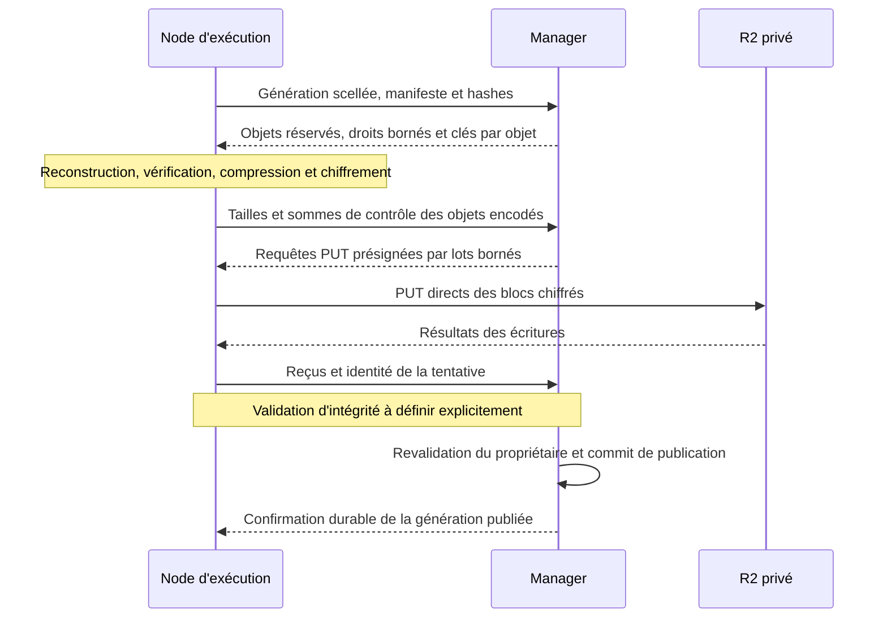

# Transferts directs entre nodes et Cloudflare R2

Date : 28 octobre 2026. Statut : étude de faisabilité, pas une décision adoptée ni une implémentation.

Suite de cette étude : le propriétaire a confirmé la confiance dans les nodes, la conversion progressive, les uploads et lectures directs et le signalement des échecs sans repli automatique. Le [cadrage architectural](adr/0076-direct-node-storage-transfers.md) consigne ces décisions ; les alternatives ci-dessous restent l'historique de l'étude initiale.

Code étudié : `leo91000/cairn`, main `86bfbbe333934aeb4c84368ccf6faa5beca8431b`. Ce SHA est la référence de cette étude, pas une affirmation sur la version actuellement déployée. Lecture du code et des documentations officielles ; aucun accès aux credentials, upload R2, benchmark ou changement de production pour cette étude.

## Conclusion

Oui : les blocs peuvent circuler directement entre les nodes et R2, avec compression et chiffrement sur les nodes. Le manager peut conserver les petites opérations de contrôle : droits, réservations, déduplication, publications et collecte. Cela retire le manager du trajet des données des nouveaux objets, sans imposer une réplication continue du journal. Les deux évolutions sont indépendantes.

Le protocole actuel ne le permet pas par simple changement d'URL. Trois sujets conditionnent une implémentation correcte : séparer les clés des objets de la clé racine de l'installation ; conserver la vérification qui rend les objets réutilisables entre conversations ; gérer les autorisations encore valides et les PUT ambigus pendant la suppression. Ces conditions découlent des contrats existants décrits ci-dessous.

La cible « aucun octet de bloc via le manager » est réalisable pour un nouveau format et les transferts ordinaires correspondants. « Le manager n'intervient plus du tout » exigerait aussi de distribuer son autorité et sa base de métadonnées, ce qui dépasse ce besoin.

## Parcours actuel vérifié dans le code

| Fonction | Répartition actuelle | Conséquence pour le transfert direct |
| --- | --- | --- |
| Capture et journal durable | La node scelle une génération et reconstruit les blocs modifiés. | Conserver cette responsabilité et le journal jusqu'au reçu final. |
| Réservation et déduplication | Le manager réserve les objets manquants dans SQLite ; seuls les objets `ready` sont réutilisés. | Échanger un plan de métadonnées, pas les contenus. |
| Transfert et codec | Le manager récupère les blocs, vérifie taille et hash, compresse, chiffre et lance les PUT. | Déplacer la transformation et les PUT sur la node. |
| Publication | Le manager réconcilie les objets concurrents, publie le manifeste et revalide le propriétaire avant le commit. | Garder cette autorité pour éviter les publications périmées. |
| Confirmation | Le manager étend les références, demande à la node de confirmer, puis retire les anciennes références. | Un succès PUT seul ne permet pas de supprimer le journal. |
| Lecture froide | La node appelle le manager ; celui-ci autorise, télécharge, déchiffre et renvoie le bloc. | Prévoir aussi GET direct et décodage sur la node. |

Sources au SHA étudié : [capture et publication](https://github.com/leo91000/cairn/blob/86bfbbe333934aeb4c84368ccf6faa5beca8431b/crates/installation/src/nodes/publication.rs#L250), [réservation des objets](https://github.com/leo91000/cairn/blob/86bfbbe333934aeb4c84368ccf6faa5beca8431b/crates/installation/src/nodes/shared_blocks.rs#L54), [vérification des blocs reçus](https://github.com/leo91000/cairn/blob/86bfbbe333934aeb4c84368ccf6faa5beca8431b/crates/installation/src/nodes/publication.rs#L824), [autorisation des lectures](https://github.com/leo91000/cairn/blob/86bfbbe333934aeb4c84368ccf6faa5beca8431b/crates/installation/src/nodes/restore.rs#L74), [requête de lecture de la node](https://github.com/leo91000/cairn/blob/86bfbbe333934aeb4c84368ccf6faa5beca8431b/crates/installation/src/storage/remote.rs#L142).

## Capacités R2 utilisables

R2 permet de signer localement des URL PUT/GET limitées à un objet et à une échéance, avec les credentials S3 déjà détenus par le manager. La signature ne demande aucun appel réseau à R2 ni nouveau Cloudflare Worker. La node reçoit une capacité temporaire, pas les credentials permanents. Les liens sont réutilisables jusqu'à expiration : ce ne sont pas des autorisations à usage unique. [Documentation des URL présignées](https://developers.cloudflare.com/r2/api/s3/presigned-urls/).

R2 propose aussi des credentials temporaires, y compris une émission locale avec opérations et chemins restreints. Pour les objets canoniques partagés, une autorisation `PutObject` ne suffit toutefois pas à imposer un en-tête de création sans écrasement. Le premier prototype devrait privilégier des requêtes présignées avec en-têtes obligatoires et testés ; l'option credentials temporaires reste utile pour d'autres parcours. [Credentials temporaires](https://developers.cloudflare.com/r2/api/s3/temporary-credentials/), [étude détaillée Cloudflare](R2-DIRECT-UPLOAD-CLOUDFLARE-2026-10-28.md).

R2 documente `If-None-Match: *` comme création atomique d'un objet absent. Il faut lier cette condition à la signature, vérifier les en-têtes réellement signés par le SDK et tester le refus de leur omission ou modification. La documentation de chaque brique ne constitue pas un test de leur combinaison dans Cairn. [Extensions S3](https://developers.cloudflare.com/r2/api/s3/extensions/#conditional-operations-in-putobject), [cohérence des écritures conditionnelles](https://developers.cloudflare.com/r2/reference/consistency/#conditional-writes).

## Généralisation à plusieurs fournisseurs

La séparation entre contrôle sur le manager et transferts sur la node ne dépend pas de R2. Les URL présignées GET/PUT SigV4 et les écritures conditionnelles existent aussi chez AWS S3. Cela fournit un socle commun, pas une preuve que tout fournisseur annonçant une API S3 implémente les mêmes garanties. [URL présignées AWS](https://docs.aws.amazon.com/AmazonS3/latest/userguide/using-presigned-url.html), [écritures conditionnelles AWS](https://docs.aws.amazon.com/AmazonS3/latest/userguide/conditional-writes.html).

Proposition : le driver fournit une requête de transfert autorisée avec méthode, URL, en-têtes obligatoires, taille, échéance et stratégie de réconciliation. Le protocole Cairn commun conserve les générations, droits, clés de données, vérification, reçus et références. Le provider déclare les capacités effectivement qualifiées : présignature, condition de création, checksums et règles de suppression. Les credentials temporaires signés par JWT local restent une option spécifique R2, pas une dépendance du protocole commun.

Pour OVHcloud, Scaleway, Garage ou tout autre backend, qualifier ces capacités avant d'activer le mode direct. Le stockage intégré est actuellement reconnu à l'adresse Docker `http://garage:3900` ; cette URL seule ne fournit pas une adresse utilisable par une node distante. Il faudra un endpoint authentifié et joignable depuis les nodes, et signer le véritable hôte utilisé par leurs requêtes. [Configuration actuelle de Storage](https://github.com/leo91000/cairn/blob/86bfbbe333934aeb4c84368ccf6faa5beca8431b/crates/installation/src/object_storage.rs#L354).

Si un provider ou une node ne satisfait pas ces conditions, signaler l'indisponibilité du mode direct ; un éventuel transit par le manager doit être un mode explicite. Les clés et le protocole de publication ne doivent pas être réimplémentés séparément pour chaque provider. Cette frontière est une proposition d'architecture, pas une abstraction actuellement livrée.

## Protocole candidat

Cette section est une proposition, pas une capacité livrée.

1. Le manager revalide la node, le droit du disque, sa génération et la destination, puis persiste l'intention et ses références avant de déléguer tout PUT. Les clés d'objets restent des incarnations uniques ; les objets déjà vérifiés évitent tout nouveau transfert. C'est l'extension des [réservations actuelles](https://github.com/leo91000/cairn/blob/86bfbbe333934aeb4c84368ccf6faa5beca8431b/crates/installation/src/nodes/shared_blocks.rs#L51).
2. Le superviseur de la node, hors de l'environnement de l'agent, reconstruit les blocs, calcule leurs identités et effectue le codec. Il garde des buffers et une concurrence bornés. Le plan porte une identité de tentative, des tailles maximales et une échéance persistée. Une longue publication renouvelle de petits lots au lieu de recevoir une autorisation globale très longue.
3. Le manager signe les PUT des objets encodés avec les contraintes retenues et validées sur R2. La node parle directement à l'endpoint S3 authentifié du bucket privé. Aucun droit de suppression ou d'énumération du bucket n'est nécessaire pour ce parcours. Il faut notamment vérifier que la signature impose la clé exacte, la condition de création et le contrôle de transfert choisi. [Base documentaire](https://developers.cloudflare.com/r2/api/s3/presigned-urls/).
4. Les résultats sont réconciliés de manière idempotente. Une réponse perdue n'est ni un succès certain ni une raison d'émettre un autre contenu sous la même clé. Un `412` impose de vérifier que l'objet existant est celui attendu ; il n'est pas automatiquement un reçu valide. R2 documente qu'un HEAD négatif ne clôt pas un PUT encore en vol. [Cohérence R2](https://developers.cloudflare.com/r2/reference/consistency/#negative-reads-and-in-flight-writes).
5. Après validation explicite des objets, le manager converge les doublons, publie son petit manifeste authentifié, revalide les droits et commet le pointeur courant. La node conserve sa génération jusqu'au reçu durable et protège les écritures plus récentes. Ce sont les invariants de [commit](https://github.com/leo91000/cairn/blob/86bfbbe333934aeb4c84368ccf6faa5beca8431b/crates/installation/src/nodes/publication.rs#L598) et de [confirmation des grants](https://github.com/leo91000/cairn/blob/86bfbbe333934aeb4c84368ccf6faa5beca8431b/crates/installation/src/nodes/disk_grants.rs#L111).

Les objets de contrôle, notamment les manifestes et petits reçus, peuvent rester envoyés par le manager. Le besoin de soulagement vise les contenus des disques ; les déplacer aussi n'est pas nécessaire pour éviter le transit des gigaoctets.

## Chiffrement : changement nécessaire

La clé `mcp-encryption-key` initialise actuellement l'AES-GCM de `Vault`. Le même objet chiffre les secrets et les blocs. L'AAD sépare les usages, mais ne permet pas de donner la clé de chiffrement d'un bloc sans donner la clé racine. [Vault](https://github.com/leo91000/cairn/blob/86bfbbe333934aeb4c84368ccf6faa5beca8431b/crates/installation/src/vault.rs#L24), [codec des blocs](https://github.com/leo91000/cairn/blob/86bfbbe333934aeb4c84368ccf6faa5beca8431b/crates/installation/src/storage/block_codec.rs#L175).

Proposition : une nouvelle enveloppe explicitement versionnée, avec clé de données limitée à une incarnation d'objet, taille, codec et emplacement authentifiés. Le manager conserve un moyen de récupérer cette clé, par exemple un emballage sous une clé de stockage dédiée. La node de destination ne reçoit que les clés des objets autorisés par son manifeste. Le choix cryptographique exact exige une conception et une revue dédiées ; cette étude ne prescrit pas un algorithme artisanal.

Les objets v2 actuels ne deviennent pas lisibles directement par simple délégation d'une nouvelle clé : ils sont déjà chiffrés avec la clé racine existante. Il faut choisir entre compatibilité de lecture via le manager pendant la transition et réencodage vérifié des anciens objets. Un réencodage effectué par le manager reste un transit ponctuel de données. Une conversion globale au démarrage serait un chantier de migration distinct, pas un préalable implicite à l'upload direct des nouveaux objets. Le lecteur actuel rejette les enveloppes autres que v2 ; l'évolution doit donc être explicite et versionnée. [Validation actuelle des enveloppes](https://github.com/leo91000/cairn/blob/86bfbbe333934aeb4c84368ccf6faa5beca8431b/crates/installation/src/storage/block_codec.rs#L208), [ADR-0036](adr/0036-compressed-immutable-disk-objects.md).

## Intégrité et partage : décision à prendre avant implémentation

Aujourd'hui le manager recalcule le hash du plaintext reçu avant de chiffrer lui-même le bloc. Les PUT utilisent `Content-MD5` pour détecter une corruption du transfert ; les lectures vérifient ensuite AES-GCM, taille, codec et hash du plaintext. [Vérification avant upload](https://github.com/leo91000/cairn/blob/86bfbbe333934aeb4c84368ccf6faa5beca8431b/crates/installation/src/nodes/publication.rs#L824), [PUT actuel](https://github.com/leo91000/cairn/blob/86bfbbe333934aeb4c84368ccf6faa5beca8431b/crates/installation/src/object_storage.rs#L601), [vérification après décodage](https://github.com/leo91000/cairn/blob/86bfbbe333934aeb4c84368ccf6faa5beca8431b/crates/installation/src/storage/block_codec.rs#L208).

Un checksum du ciphertext accepté par R2, un ETag, un HEAD ou une déclaration de la node ne démontre pas que le contenu déchiffré correspond au hash de bloc annoncé. Marquer immédiatement l'objet `ready` sur cette seule déclaration retire une vérification existante ; avec la déduplication entre conversations, cela peut affecter d'autres disques. C'est une conséquence de la [réutilisation des seuls objets ready](https://github.com/leo91000/cairn/blob/86bfbbe333934aeb4c84368ccf6faa5beca8431b/crates/installation/src/nodes/shared_blocks.rs#L51).

Deux modèles sont possibles, à choisir explicitement :

- Faire du superviseur de publication sur la node une autorité de vérification de confiance. Il valide le plaintext, sa transformation et le résultat distant. Le modèle de confiance change : une simple signature de ses déclarations n'est pas une preuve indépendante de leur exactitude. Même dans une installation privée, ce changement doit être assumé et testé.
- Préserver une vérification indépendante avant réutilisation globale. Un vérificateur d'installation placé sur une node télécharge directement depuis R2, authentifie, décode et vérifie le plaintext ; le manager reçoit le verdict borné. Cela maintient les données hors du manager, mais ajoute du travail et potentiellement un GET par nouvel objet. Un objet en attente de vérification ne doit être ni promu ni réutilisé ; ses références et le journal source restent protégés. Le choix d'un vérificateur et son niveau de confiance restent à définir.

Dédupliquer seulement dans le périmètre de la conversation/node limiterait une partie des interactions, mais modifierait aussi le contrat actuel de partage. Ce n'est pas une simplification gratuite. Ne pas résoudre ce sujet en supprimant silencieusement les contrôles ou le chiffrement.

## Autorisations, révocation et collecte

Les nouvelles autorisations doivent rester liées au droit existant du disque, à la node, à la tentative, au stockage exact et à des objets réservés. La politique ne donne jamais la clé S3 permanente, la clé Vault, un droit de suppression ou un accès global aux objets partagés à l'environnement d'un agent. La révocation du grant bloque la création et le renouvellement de capacités et interdit le commit d'une publication périmée. [Contrôles actuels des grants](https://github.com/leo91000/cairn/blob/86bfbbe333934aeb4c84368ccf6faa5beca8431b/crates/installation/src/nodes/disk_grants.rs#L55).

Une capacité déjà émise n'est pas annulée par un changement dans SQLite. Les droits courts imposent une fenêtre de révocation bornée à concevoir ; les octets et clés déjà délivrés ne peuvent pas être repris. Il faut conserver les pins de lecture pendant la validité des GET et les transferts concernés. Pour les PUT, persister les échéances et conserver des tombstones/intents pour réconcilier les écritures tardives, y compris après crash du manager.

La collecte actuelle attend cinq minutes après disparition des références puis oublie l'incarnation supprimée après un DELETE réussi. Avec des PUT externes, une autorisation encore valable pourrait recréer cette même clé après suppression, même avec `If-None-Match: *`. Il faut donc adapter la collecte à la fin effective des capacités et des écritures en vol ; le délai actuel ne suffit pas par construction. R2 confirme que l'absence observée n'annule pas un PUT en cours. [Collecte actuelle](https://github.com/leo91000/cairn/blob/86bfbbe333934aeb4c84368ccf6faa5beca8431b/crates/installation/src/nodes/shared_blocks.rs#L271), [R2 : écritures en vol](https://developers.cloudflare.com/r2/reference/consistency/#negative-reads-and-in-flight-writes).

Les logs ne doivent contenir ni URL signée complète, ni clé de données, ni credentials temporaires. Le client contrôle l'endpoint HTTPS autorisé, ne suit pas une redirection avec ses capacités et borne taille, durée, buffers et concurrence. Ces contraintes s'appliquent au superviseur, aux réponses d'API, aux erreurs SDK et à la télémétrie.

## Lecture directe et disponibilité

Un premier lot peut traiter l'upload des nouveaux objets. Pour retirer aussi le manager du trajet des restaurations et lectures froides, il faut délivrer des GET courts et les clés des seuls objets présents dans les manifestes autorisés, puis effectuer déchiffrement, décompression et vérification sur la node. Les grants et publications épinglées restent la source des droits. [Parcours de lecture actuel](https://github.com/leo91000/cairn/blob/86bfbbe333934aeb4c84368ccf6faa5beca8431b/crates/installation/src/nodes/restore.rs#L74).

Les données téléchargées peuvent éviter le manager ; le renouvellement des capacités et le commit du nouvel état restent dépendants de lui. Une panne du manager n'autorise donc pas automatiquement une node à poursuivre indéfiniment ou à publier elle-même un nouveau pointeur. Une tolérance explicite à cette panne nécessiterait des leases préaccordées, une reprise et des règles de révocation propres.

Les anciennes lectures v2 et les conversions VM/natif requièrent un traitement explicite. Le code possède aussi une publication de disque converti qui chiffre et envoie depuis le manager ; déplacer seulement `start_uploads` ne couvre pas cette route. [Publication de conversion](https://github.com/leo91000/cairn/blob/86bfbbe333934aeb4c84368ccf6faa5beca8431b/crates/installation/src/nodes/publication.rs#L724).

## Effet attendu et limites

Les gains attendus, non mesurés ici, sont la suppression du trafic node → manager pour les nouveaux blocs, du trafic manager → R2 de ces contenus et du codec correspondant sur le manager. La charge de compression, hashing et chiffrement passe aux nodes ; le volume réel à stocker, la reconstruction et la latence R2 subsistent. Un vérificateur indépendant ajoute son propre coût.

L'upload direct peut être implémenté en conservant les captures par blocs de 4 Mio. Il ne supprime donc pas leur amplification des petites écritures, ni le retard si la production de données dépasse le débit vers R2. Il ne suffit pas non plus de conserver le scheduler actuel inchangé : il limite les synchronisations à deux, y compris pendant les longues opérations réseau. Le futur protocole doit borner le travail par node et la coordination globale sans conserver un slot global rare durant tout un transfert indépendant. [Limite actuelle](https://github.com/leo91000/cairn/blob/86bfbbe333934aeb4c84368ccf6faa5beca8431b/crates/installation/src/nodes/coordination.rs#L11), [scheduler](https://github.com/leo91000/cairn/blob/86bfbbe333934aeb4c84368ccf6faa5beca8431b/crates/installation/src/nodes/publication.rs#L1410).

## Étapes proposées et critères de validation

1. Arrêter le modèle de confiance pour la vérification et le format de clés/objets ; documenter l'évolution de l'ADR-0036 sans considérer cette étude comme son remplacement.
2. Faire un prototype isolé de PUT présignés créant uniquement des objets nouveaux, avec credentials synthétiques puis une destination R2 de test autorisée séparément. Tester les en-têtes manquants ou altérés, mauvais checksum, mauvais objet, taille excédée, URL expirée, PUT concurrent, timeout après acceptation et réponse perdue. Ne pas déduire cette validation d'un mock S3 seul.
3. Intégrer la réservation durable, le transfert sur la node, la validation, le commit et les reçus. Tester deux nodes partageant le même hash, annulation, suppression, déplacement et révocation à chaque frontière ; redémarrer manager et node avant/après PUT et avant/après commit. Vérifier les pins et la collecte des uploads tardifs.
4. Ajouter les lectures directes, la vérification bornée du codec et la coexistence temporaire avec v2. Restaurer sur une autre node avec une source éteinte et contrôler l'identité exacte des octets et les grants révoqués.
5. Comparer au même workload de référence : octets node/manager/R2, CPU et mémoire de chaque rôle, p50/p95/p99 et maximum des E/S de l'agent, âge du travail non synchronisé, débit, coût des opérations R2 et intégrité après crash. Réutiliser l'instrumentation par publication en cours de développement ; ne promettre aucun facteur d'accélération avant mesure.

Recommandation : poursuivre cette piste avant une réécriture complète en export continu, car elle traite directement la centralisation du trafic et du codec. Les logs de décomposition restent nécessaires pour chiffrer le gain et décider ensuite si la granularité des blocs doit changer.
