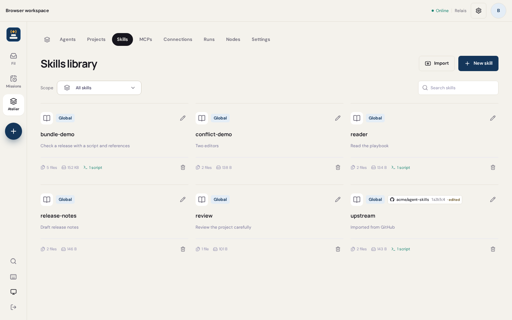
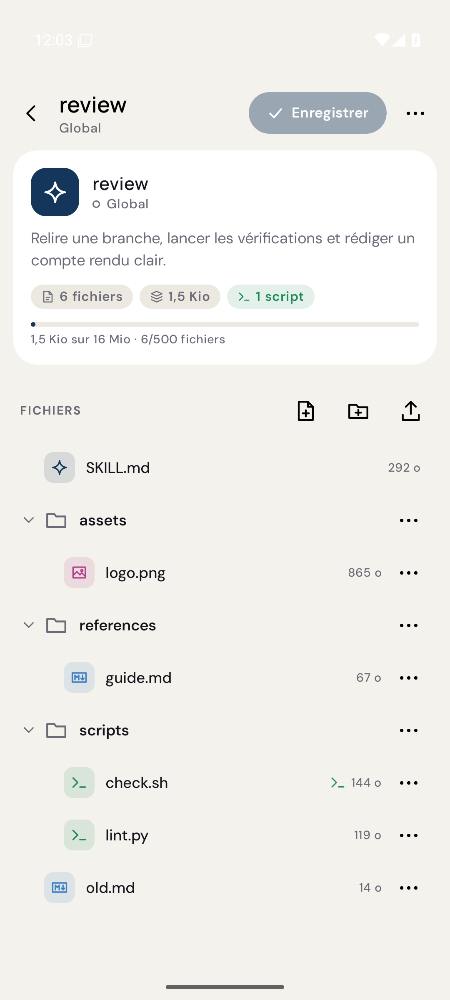
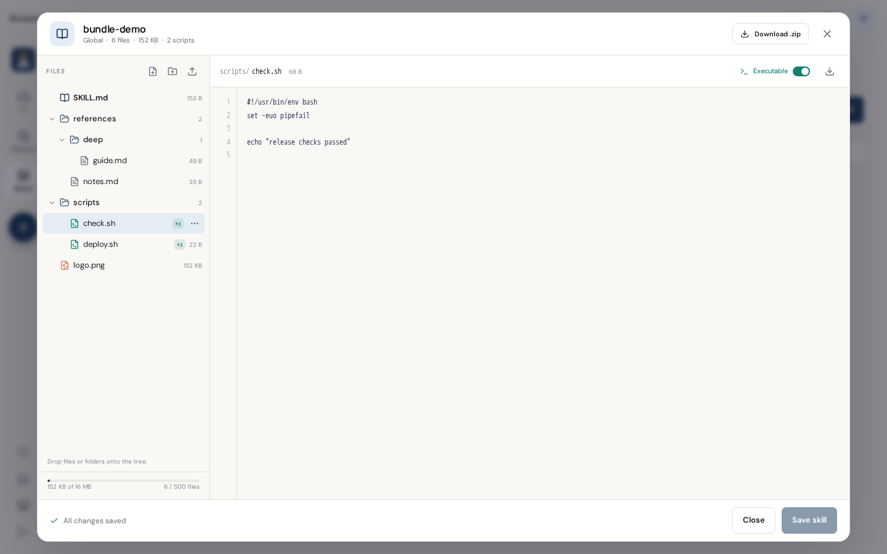
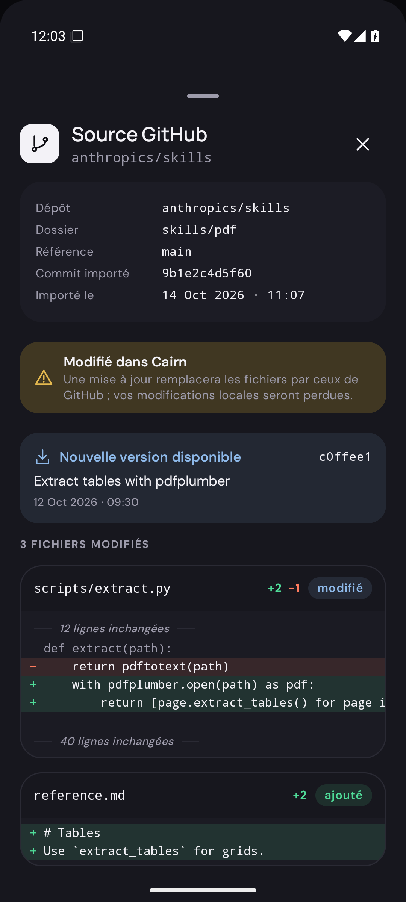
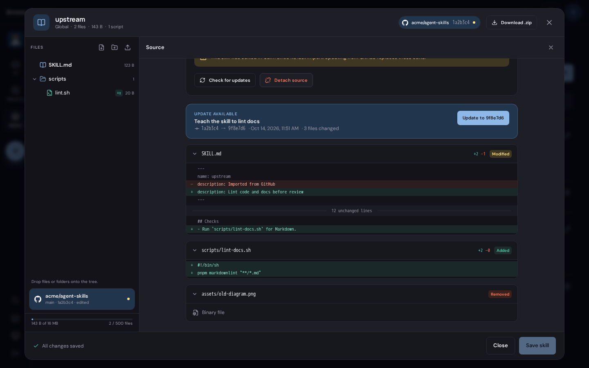

# Skills

A skill is a directory under `.agents/skills/<name>/`, in the installation
home (`global` scope) or in a project (scope = project id). `SKILL.md` holds the
YAML frontmatter (`name`, `description`) and the instructions. Every other file
in the directory is a supporting file: references, templates, scripts, images.
Runs receive the whole directory. Names starting with `.` are not part of a
skill: Cairn neither lists nor delivers them.

## Limits

| Limit | Value |
| --- | --- |
| `SKILL.md` | 100 KB, UTF-8 |
| Supporting file | 4 MiB |
| Skill total | 16 MiB |
| Files per skill | 500 |
| Path | 240 bytes, at most 8 segments; no segment starts with `.` |
| Staged upload | 5 MiB |
| Imported archive | 5 MiB compressed |

`GET /skills/:scope/:name/bundle` returns these values in `limits`; clients read
them instead of hard-coding them.

A file is **text** when it is valid UTF-8 without NUL bytes. A file is
**executable** when any execute bit is set. Cairn writes executables `0700`
and other files `0600`. When a write does not specify `executable`, a new file
is executable when it starts with `#!`, and an existing file keeps its mode.

## Revisions

The **revision** of a skill is a BLAKE3 hash over its sorted paths, modes and
contents. Edits send the revision they started from as `base`. A different
current revision returns `409` so that two editors do not overwrite each other.

## API

All routes are installation API routes. Members may read skills; only the owner
writes, imports and uses the source routes, which read GitHub through the
owner’s connection.

### `GET /skills`

Each listing item adds `files`, `bytes` and `executables` (counts over the
whole directory) and `source` (see below, or `null`).

### `GET /skills/:scope/:name/bundle`

```json
{
  "scope": "global",
  "name": "review",
  "revision": "4f1c…",
  "files": [
    { "path": "SKILL.md", "size": 812, "executable": false, "text": true },
    { "path": "scripts/check.sh", "size": 210, "executable": true, "text": true },
    { "path": "assets/logo.png", "size": 5120, "executable": false, "text": false }
  ],
  "limits": { "fileBytes": 4194304, "bundleBytes": 16777216, "files": 500, "uploadBytes": 5242880 },
  "source": null
}
```

### `GET /skills/:scope/:name/file?path=…`

`{ "content": "…", "encoding": "utf-8" | "base64", "size": 210, "executable": true }`.
Text files use `utf-8`; other files use `base64`.

### `PUT /skills/:scope/:name/file`

Writes one small file immediately: `{ "path", "content", "encoding"?, "executable"? }`.
Kept for older clients. New editors use the batch below.

### `POST /skills/uploads`

Stages one file before a batch or an import. The request body is the raw file
(`Content-Type: application/octet-stream`, at most 5 MiB); the response is
`{ "id": "…", "size": 5120 }`. An upload is consumed by the batch or import
that uses it and expires after one hour.

### `POST /skills/:scope/:name/bundle`

Applies every change at once, then validates the result and swaps it in. The
skill never shows a partial save.

```json
{
  "base": "4f1c…",
  "changes": [
    { "op": "write", "path": "SKILL.md", "content": "---\nname: review\n…" },
    { "op": "write", "path": "scripts/check.sh", "content": "#!/bin/sh\n…", "executable": true },
    { "op": "write", "path": "assets/logo.png", "upload": "<upload id>" },
    { "op": "write", "path": "assets/icon.png", "content": "<base64>", "encoding": "base64" },
    { "op": "move", "from": "notes.md", "to": "references/notes.md" },
    { "op": "mode", "path": "scripts/run.py", "executable": true },
    { "op": "delete", "path": "old.md" }
  ]
}
```

- `base: null` creates the skill; it fails with `409` when the name exists.
- Changes apply in order. `delete` and `move` act on files; a folder is renamed
  or removed by sending one change per file. Empty folders disappear.
- The result must contain a valid `SKILL.md` whose `name` equals `:name`, and
  stay within the limits.
- JSON request bodies are limited to 150 KB. Send small text files inline and
  stage binary or larger files with `POST /skills/uploads`.
- The response is the new bundle (as `GET …/bundle`) plus `description`.

### `POST /skills/:scope/import`

Imports a new skill from an archive or from GitHub. The skill name comes from
the `SKILL.md` frontmatter; an existing name returns `409`.

From a staged `.zip` or `.skill` upload:

```json
{ "source": "archive", "upload": "<upload id>", "path": "optional/folder" }
```

From GitHub (`ref` defaults to the default branch):

```json
{ "source": "github", "repository": "owner/repo", "path": "skills/review", "ref": "main" }
```

The skill folder is `path`, or the only folder containing a `SKILL.md`, or the
archive's single top-level folder. When several skill folders match, nothing is
imported and the response lists them so the user can choose:

```json
{ "imported": null, "candidates": ["skills/review", "skills/triage"] }
```

On success: `{ "imported": <bundle>, "candidates": [] }`. Files whose names
start with `.` and `__MACOSX/` entries are skipped. GitHub imports use the
installation's GitHub connection, so private repositories work when that
connection can read them.

### `GET /skills/:scope/:name/archive?offset=0&revision=…`

Exports a `.zip` whose single top-level folder is the skill. A response carries
at most 4 MiB:

`{ "filename": "review.zip", "revision": "4f1c…", "size": 9123, "offset": 0, "content": "<base64>" }`

Clients repeat the request with `offset += decoded length` and the same
`revision` until `offset == size`. A changed skill returns `409`.

### GitHub source

A skill imported from GitHub records its **source**:

```json
{
  "type": "github",
  "repository": "owner/repo",
  "path": "skills/review",
  "ref": "main",
  "commit": "9b1e…",
  "importedAt": 1791976037271,
  "modified": false
}
```

`modified` is true when the skill changed in Cairn since its import or last
update.

- `GET /skills/:scope/:name/source` checks `ref` for a newer commit:
  `{ "source", "latest": { "commit", "message", "date" }, "current": bool, "changes": [...] }`.
  Each change is `{ "path", "status": "added" | "removed" | "modified", "binary": bool, "lines"?: [{ "kind": "context" | "added" | "removed" | "gap", "text" }] }`.
  The diff shows upstream changes between the recorded commit and the latest one,
  with three lines of context; a `gap` line such as "12 unchanged lines" stands
  for the rest.
  Text diffs are omitted for files over 2,000 lines.
- `POST /skills/:scope/:name/source/update` with `{ "commit", "base" }` replaces
  the skill with that commit's files. Local edits are lost; clients warn when
  `modified` is true.
- `DELETE /skills/:scope/:name/source` keeps the files and forgets the source.

## MCP tools

The owner's MCP clients (management scopes, see [MCP](MCP.md)) use the same
operations. Agents' run-scoped installation tools do not manage skills.
Tools: `list_skills`, `read_skill` (a skill's files, or one file with `path`),
`save_skill` (only `SKILL.md`) and `edit_skill_files` (a batch, as
`POST …/bundle`, with inline content).

## Runs

When a run or conversation is created, Cairn freezes each selected skill into
a content-addressed bundle under the data directory and records its revision in
the run snapshot. The run installs exactly that bundle, so later edits do not
change queued or restarted runs. Modes are preserved: scripts stay executable
inside the VM.

The prompt lists each selected skill by name, description and `SKILL.md` path.
The agent reads `SKILL.md` and its supporting files when it uses the skill.

## Screens

| Web | Android |
| --- | --- |
|  |  |
|  |  |
|  | |
