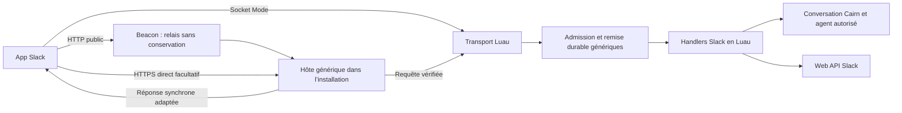

# Plugin Slack : contrat de réalisation

Statut : Q1–Q20 acceptées ; compréhension partagée confirmée et réalisation lancée.
Le suivi d’implémentation distingue les fonctions terminées des lots restants. Le
[cadrage détaillé](SLACK-PLUGIN-DESIGN.md) conserve les décisions et les recherches.

## Résultat attendu

Un package Slack multi-fichiers en Luau couvre trois rôles activables séparément :
discuter avec les agents depuis Slack, donner des outils Slack aux agents et
déclencher du travail depuis des événements ou workflows. Cairn fournit des API
génériques ; aucun transport, formulaire, écran ou client Slack spécifique n’est
ajouté au code natif.

Une installation gère plusieurs apps Slack privées, chacune pouvant avoir plusieurs
installations dans des workspaces lorsque Slack l’autorise. Les workspaces
indépendants qui utilisent des étapes Workflow Builder peuvent avoir des apps
distinctes. La distribution publique au Marketplace et l’administration globale
Enterprise/SCIM/audit sont hors de cette livraison.

## Parcours et droits

Le propriétaire choisit les fonctions, crée l’app chez Slack à partir du manifeste
généré, puis suit l’installation/OAuth et les diagnostics. Cairn fournit les URL,
les liens et un mode manuel avancé. Un brouillon permet les callbacks de
configuration et le challenge vérifié, sans recevoir de travail opérationnel ni
accorder de droits aux agents. Ces parcours et les vues
déclaratives sont disponibles nativement sur web et Android.

L’instance de plugin représente une app Slack. Les installations workspace/org,
autorisations personnelles, routes de conversation et règles d’automatisation
sont des ressources déclaratives rattachées à cette instance. Les secrets de chaque
ressource restent gérés par l’hôte. Le plugin ne choisit jamais un jeton par défaut
quand l’identité workspace/org d’une requête est ambiguë.

Les profils **Lecture**, **Contribution** et **Gestion** s’appliquent par agent et
périmètre Slack, avec réglage fin ; aucun agent n’est autorisé par défaut. Le bot
sert aux fonctions courantes. Les fonctions personnelles utilisent une autorisation
OAuth facultative propre à leur demandeur. Un droit Cairn ne remplace pas les
scopes, la visibilité, l’appartenance ou les droits de gestion exigés par Slack.

## Conversations et données

- Dans un canal, le bot répond aux mentions, commandes et raccourcis, puis suit les
  fils engagés. L’écoute de tous les messages est une option explicite. Il répond
  aux DM. L’agent et le projet éventuel sont configurés par workspace/canal.
- Un fil Slack correspond à une conversation Cairn. Son contexte initial est
  borné à l’historique autorisé du fil, avec des limites affichées. Une demande DM
  hors fil crée une nouvelle conversation ; reprendre un fil poursuit l’existante.
  Une commande et un bouton permettent de repartir à zéro.
- Les participants autorisés peuvent contribuer. Les messages d’auteurs différents
  sont exécutés sous leur propre autorité ; ils ne pilotent pas l’exécution en
  cours d’un autre auteur ni n’héritent de son OAuth. Seul l’auteur de l’exécution
  peut répondre à ses questions ou l’arrêter depuis Slack. Le propriétaire garde
  le contrôle depuis Cairn ; il ne reçoit pas pour autant l’OAuth d’une autre personne.
- Les échanges ordinaires importés, y compris DM et canaux privés, sont partagés
  dans l’installation et suivent la conservation Cairn. L’information est explicite
  à la configuration et avant le premier échange privé. Les modifications et
  suppressions de source sont signalées et prises en compte lors des chargements
  suivants ; elles n’effacent pas rétroactivement le travail et l’historique Cairn.
- La recherche RTS utilise une consultation éphémère distincte, réservée au
  demandeur. Résultats, synthèses et citations restent sans archivage. Les moteurs
  dont l’absence de conservation n’est pas prouvée proposent uniquement la
  consultation humaine. Les outils d’un run ordinaire peuvent ouvrir cette
  consultation, sans injecter ses résultats dans un historique persistant.
  Cette voie ne publie pas ses réponses dans un canal partagé ou une autre surface
  persistante ; l’affichage reste propre au demandeur.

Exemple : Alice lance un travail dans un fil et Bob ajoute une demande. Bob peut
contribuer au même fil s’il est autorisé ; sa demande conserve son identité et ses
droits. Elle ne valide pas une question destinée à Alice et n’utilise pas ses
autorisations personnelles.

## Transports et fiabilité

Chaque app sélectionne Socket Mode ou HTTP ; Slack ne les utilise pas pour une
double livraison simultanée. Un changement de transport conserve les mêmes
frontières d’admission et de déduplication. Le callback OAuth HTTPS existe aussi
en Socket Mode.



Le point d’entrée Beacon fonctionne avec l’installation derrière un NAT. Le
propriétaire peut exposer son propre HTTPS direct. Les deux voies nécessitent une
installation en ligne ; Beacon ne conserve ni secrets ni contenu à rejouer.

Le contrat de protocole impose :

- HTTP : octets originaux et en-têtes préservés, HMAC/timestamp vérifiés avec le
  secret de l’app avant traitement, comparaison constante, protection contre les
  relectures et vérification du challenge. Les secrets ne passent pas dans Luau.
- Des réponses adaptées dans les trois secondes : accusé d’événement, options
  dynamiques ou validation/action de modal selon le type. Ouvrir un modal respecte
  aussi l’expiration du `trigger_id`. Un HTTP 200 vide systématique est incorrect.
- Socket Mode : URL temporaire, Hello, surveillance de vie, remplacement de
  connexion, raisons de déconnexion, reconnexion bornée et accusés d’enveloppes.
  Un transport appartient à l’app, pas à chaque canal. Le traitement lent ne
  retarde pas les accusés ou la surveillance du socket.
- Admission durable avec résultats distincts : accepté, doublon, refusé, accès à
  demander, saturation temporaire. La saturation ne doit pas être acquittée comme
  un travail accepté. Les refus ne conservent pas le contenu non admis.
- Limitation REST par méthode/workspace/app, prise en compte de `Retry-After` et
  de `ok: false` même avec HTTP 200. Les écritures au résultat incertain ne sont
  pas relancées aveuglément. Aucun engagement « exactement une fois » n’est déduit
  des retries Slack.
- À réception tardive d’une nouvelle demande : exécution automatique jusqu’à
  15 minutes par défaut ; au-delà, reprise explicite par son auteur. La fenêtre
  est configurable, et chaque automatisation a sa propre limite. Le travail déjà
  accepté suit la reprise Cairn sans nouveau déclenchement. Les événements jamais
  livrés ne sont pas présentés comme récupérés ; les lacunes sont visibles.

## Catalogue initial et profils

Les familles ci-dessous sont le périmètre de réalisation ; la disponibilité réelle
est diagnostiquée selon les scopes, l’identité, l’accès et le forfait. Les scopes
du manifeste généré correspondent aux fonctions activées.

| Famille | Opérations et interfaces Slack | Profil minimal et limites |
| --- | --- | --- |
| Canaux et messages | `conversations.list/info/members/history/replies` | Lecture ; types de canal et visibilité respectés |
| Personnes | `users.list/info/profile.get`, découverte des groupes/emoji | Lecture ; e-mail seulement avec scope dédié |
| Recherche | `assistant.search.context` et capacité `assistant.search.info` | Lecture, uniquement voie éphémère ; OAuth individuel hors Slack/privé, `action_token` quand requis |
| Messages et fils | `chat.postMessage/postEphemeral/update/delete` | Contribution pour publier/modifier ses messages ; Gestion pour supprimer ; droits de l’acteur toujours appliqués |
| Envois programmés | `chat.scheduleMessage/scheduledMessages.list/deleteScheduledMessage` | Contribution ; limites Slack, messages du même jeton, fenêtre d’annulation respectées |
| Réactions | `reactions.get/add/remove` | Lecture/Contribution ; retrait de ses propres réactions |
| Liens et épingles | `bookmarks.list/add/edit/remove`, `pins.list/add/remove` | Lecture/Contribution/Gestion selon l’opération |
| Gestion ordinaire des canaux | `conversations.create/rename/archive/unarchive/join/leave/invite/kick/setTopic/setPurpose` | Gestion ; appartenance et droits Slack restent nécessaires |
| DM et groupes | `conversations.open/close` | Contribution ; identité de l’acteur, pas d’effacement d’historique par fermeture |
| Fichiers | `files.list/info`, téléchargement authentifié ; `getUploadURLExternal`, transfert multipart, `completeUploadExternal`, `delete` | Lecture/Contribution/Gestion ; limites Cairn affichées ; pas de `files.upload` legacy |
| Canvases | `canvases.getContent/sections.lookup/create/edit/delete/access.set/access.delete` | Lecture/Contribution/Gestion ; restrictions de forfait et d’accès |
| Listes | `slackLists.items.list/info/create/update/delete/deleteMultiple`, `create/update`, `download.start/get`, `access.set/delete` | Lecture/Contribution/Gestion ; forfait compatible ; aucune suppression de liste entière non documentée n’est promise |
| Profil personnel | `users.profile.set` | Contribution et OAuth du demandeur ; aucune administration des profils d’autres personnes |
| Workflows | Événements vers Cairn, `function_executed` puis `functions.completeSuccess/completeError`, invocation de webhooks configurés | Règles préautorisées et contexte d’exécution ; limites de distribution et de forfait |
| Interface Slack | App Home, commandes, raccourcis, boutons, sélecteurs, `views.publish/open/update/push` | Admission et contrôle de l’auteur ; réponses synchrones correctes |
| Agent natif | `agent_view`, `agents.sessions.setStatus/rename`, `agent_session_stopped`, `chat.startStream/appendStream/stopStream` | Bot autorisé ; gestion de statut, destinataire et arrêt réel du travail |

Les liens vers les livrables conservent leur visibilité Cairn ; aucune publication
publique automatique n’est induite par un envoi Slack. Les copies de fichiers vers
Slack sont bornées au périmètre et aux droits accordés.

## Automatisations

Chaque règle activée définit une source, ses conditions, l’agent/projet et ses
plafonds. Les événements humains conservent l’admission de leur auteur. Les
événements sans auteur humain utilisent une autorisation propriétaire dédiée à la
règle ; le plugin ne peut pas fabriquer une identité propriétaire dans un message.

Les plafonds stricts portent sur déclenchements, cadence, durée et concurrence.
L’usage/coût mesurable est indiqué séparément ; les pourcentages de capacité d’un
abonnement ne deviennent pas un coût par exécution. Un montant estimé ne constitue
pas un plafond de facture garanti. Les règles sont revérifiées avant admission et
au changement d’autorisation ; arrêter la règle empêche les nouveaux travaux.

## API génériques nécessaires

Ces interfaces décrivent les responsabilités attendues ; leur syntaxe définitive
sera stabilisée dans les types, manifeste, documentation et tests du même chantier.

| Interface générique | Contrat attendu |
| --- | --- |
| Réception HTTP déclarée | Routes publiques limitées à une instance approuvée et activée, ou au seul parcours de configuration d’un brouillon autorisé et expirant ; vérification paramétrée avec secrets gérés par l’hôte ; octets/en-têtes originaux ; réponses bornées adaptées ; relais Beacon et accès direct |
| OAuth et secrets référencés | Fournisseur/endpoints/scopes déclarés ; état à usage unique lié au demandeur/app/brouillon ; échange, stockage chiffré, renouvellement atomique, révocation et capture des valeurs sensibles côté hôte |
| Ressources et collections déclaratives | Configurer apps, installations workspace/org, routes, règles et autorisations sans pages Slack natives ; pagination et contrôles web/Android |
| Périmètres et profils | Déclarations d’opérations et ressources ; autorité du demandeur et droits d’agent vérifiés par l’hôte ; contrôle après I/O et révocation ; aucun contournement via CLI/outils/choix d’instance |
| Remise d’événements | Admission, déduplication, durabilité et retour de saturation précis ; voie rapide séparée du travail lent et contrôle des actions périmées |
| Socket | Envoi/accusé réellement rapide, surveillance et remplacement avec chevauchement si nécessaire, identifiants de connexions et limites par app |
| Fichiers authentifiés | Téléchargement binaire borné vers une pièce jointe autorisée avec secret injecté ; réutilisation du multipart existant ; aucun secret ou binaire massif transmis au script |
| Exécution d’une règle | Autorisation dédiée et identité vérifiée, compteurs transactionnels, cadence/âge/concurrence/durée, arrêt et déduplication ; réutilisation des contrats Tasks lorsque pertinente |
| Consultation éphémère | Demandeur authentifié et données non conservées sur tout le parcours ; aucune sortie normale MCP/CLI persistante ; désactivation des capacités de conservation/export ; activation moteur uniquement sur preuve |

Les parcours OAuth doivent traiter la rotation des jetons app/bot/utilisateur, les
installations Enterprise sans team fixe et les changements d’accès Slack Connect.
Les URL de socket, `response_url` et jetons d’interaction sont des valeurs sensibles
de courte durée ; ils ne doivent pas apparaître dans les diagnostics ou réglages
ordinaires. Les suppressions/révocations invalident les références correspondantes.

## Structure du package proposée

```text
plugins/slack/
  manifest.json
  main.luau
  socket.luau
  webhook.luau
  setup.luau
  app_manifest.luau
  conversation.luau
  automation.luau
  surfaces.luau
  tools/
    messages.luau
    conversations.luau
    files.luau
    content.luau
    people.luau
    search.luau
  lib/
    api.luau
    identity.luau
    formatting.luau
    limits.luau
```

## Validation et livraison

Le périmètre complet est réalisé par étapes vérifiables : contrat/API et fixtures,
transports et authentification, conversations et fichiers, outils et workflows,
recherche éphémère, puis parcours complets et documentation. Une interface native
ne sert pas de raccourci temporaire pour masquer une capacité absente du package.

Avant de déclarer les fonctions validées :

1. Tests contre le vrai worker Luau avec faux Slack HTTP/WSS : signatures, formats,
   délais/accusés, reconnexions, doublons, panne après acceptation, saturation,
   rotation, identités multi-app/workspace/org/Connect, erreurs et limites REST.
2. Tests des contrôles d’auteur, des profils et des révocations dans les voies
   événements, CLI, outils, HTTP, actions et automatisations ; cas Alice/Bob et
   actions provenant d’un ancien run explicitement couverts.
3. Preuve distincte pour la consultation éphémère : événements, sessions natives,
   journaux, fichiers, exports et caches clients. Aucune compatibilité moteur
   déclarée uniquement parce que l’interface masque un résultat.
4. Tests de parcours navigateur et Android, dont création/configuration, OAuth,
   groupes/collections, modes Socket/HTTP, questions/arrêt, fichiers et diagnostics.
   Vérifications requises par `AGENTS.md` et parité documentée.
5. Essai dans un vrai workspace Slack pour les deux transports et les fonctions
   selon le forfait disponible. Séparer cette preuve des fixtures ; une fonction
   non testée en réel reste indiquée comme telle.
6. Revue du format persistant et du contrat de compatibilité avant toute migration
   ou rupture de rollback. Aucun support API v1 ou ancien protocole n’est ajouté.

Références figées pour la comparaison, sans ajout de dépendance au plugin :

- [`@slack/web-api` 8.2.0](https://github.com/slackapi/node-slack-sdk/releases/tag/%40slack/web-api%408.2.0)
  et [`@slack/socket-mode` 3.1.0](https://github.com/slackapi/node-slack-sdk/releases/tag/%40slack/socket-mode%403.1.0),
  commit `a98047a7f27149812664c78e2dccfe4155b0e145`.
- [`@slack/oauth` 4.0.0](https://github.com/slackapi/node-slack-sdk/releases/tag/%40slack/oauth%404.0.0),
  commit source `70e15b8442745d215f9ae259a2c970b306aff51a` (tag annoté résolu).

La documentation actuelle fait foi pour les méthodes absentes de ces SDK,
notamment [`canvases.getContent`](https://docs.slack.dev/reference/methods/canvases.getContent/)
et [`assistant.search.context`](https://docs.slack.dev/reference/methods/assistant.search.context/).
Les scopes et limites seront consignés méthode par méthode dans les déclarations
du package et leurs tests, avec les références relevées le 2026-10-17.

Décisions : [apps privées](adr/0048-private-slack-apps-per-installation.md),
[réception HTTP](adr/0049-plugin-public-http-ingress.md),
[autorisations personnelles](adr/0071-personal-plugin-authorizations.md),
[consultation éphémère](adr/0072-transient-plugin-contexts.md).
